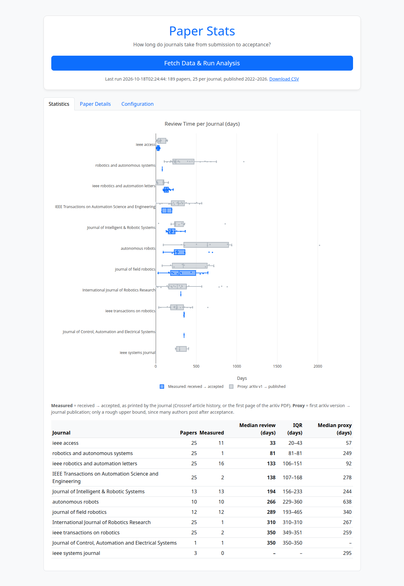

# Paper Stats

How long do journals take to review a paper? Paper Stats samples recent papers from a list of journals and measures **received → accepted** time from the dates the journals print. It shows the results as per-journal box plots, a summary table and a CSV.

It was built for robotics and automation venues (T-RO, RA-L, IJRR, JFR, Autonomous Robots, ...), but any journal whose papers appear on arXiv works.



*The 2026-10-18 run: 189 papers from 11 journals, 69 with a measured review time.*

## How it works

```
list_of_journals.txt
        │
        ▼
 arXiv API  (jr:"<journal>", newest first)  ──►  candidate papers + DOI
        │
        ▼
 Crossref  (/works/<doi>)  ──►  venue check, publication date,
        │                       received/accepted (Springer, Wiley)
        ▼  no dates?
 arXiv PDF, page 1  ──►  "Manuscript received …; accepted …" (IEEE)
        │
        ▼
 review_days = accepted − received        (measured)
 proxy_days  = published − arXiv v1       (fallback, plotted separately)
```

1. **Find papers.** arXiv's journal-reference search returns papers whose authors said where they were published, along with the DOI.
2. **Check the venue.** Crossref's container title has to match the journal name exactly, ignoring case, punctuation, "&" and a leading "The". Without this check, *Robotics and Autonomous Systems* would also match *Annual Review of Control, Robotics, and Autonomous Systems*.
3. **Get the dates**, best source first:
   | Source | Where the dates come from | Typical publishers |
   |---|---|---|
   | `crossref` | Article history the publisher deposits in Crossref | Springer, Wiley |
   | `pdf` | Footnote on the first page of the arXiv PDF | IEEE (when authors upload the final version) |
   | `proxy` | No review dates: only arXiv v1 → journal publication | SAGE, Elsevier, and any paper above with no dates |
4. **Summarize.** For each journal: sample size, how many papers have a measured review time, the median and interquartile range, and the median proxy.

The proxy is **not** a review time. Many authors post to arXiv after acceptance, which makes it short or even negative (negative values are dropped). Others post long before submitting. It is shown so journals without published dates still appear, but it is plotted and summarized separately.

## Quick start

Requires Python 3.9 or newer (tested on 3.12). From the repository folder:

```bash
python3 -m venv venv
venv/bin/pip install -r requirements.txt
venv/bin/python server.py
```

Open http://127.0.0.1:5000 and click **Fetch Data & Run Analysis**. The progress bar shows which journal is being processed.

The first run is slow on purpose. arXiv asks for one request every 3 seconds, and each IEEE paper needs its PDF downloaded. With the bundled 12 journals × 25 papers it took 32 minutes. Lookups are cached in `cache.json`, so a rerun took under 2 minutes and only fetches new papers.

### Environment variables

| Variable | Default | Purpose |
|---|---|---|
| `HOST` | `127.0.0.1` | Set `0.0.0.0` to reach the app from other devices on your network |
| `FLASK_DEBUG` | off | `1` enables the Werkzeug debugger. Never combine it with `HOST=0.0.0.0`: the debugger runs arbitrary code |
| `SECRET_KEY` | random per process | Flask session key (only used for flash messages) |
| `CROSSREF_MAILTO` | empty | Your email, sent to Crossref so it puts you in its more reliable "polite" pool |

## Configuration

`config.json`, also editable in the **Configuration** tab:

| Key | Meaning |
|---|---|
| `num_samples` | Usable papers per journal (measured or proxy) |
| `year_start`, `year_end` | Journal publication year range, inclusive |
| `mine_pdfs` | Read dates from arXiv PDFs when Crossref has none. Needed for IEEE journals |

`list_of_journals.txt` holds one journal per line. Use the journal's official title, because it must match Crossref's.

## Output

- **Statistics tab:** grouped horizontal box plots (measured vs proxy), every paper shown as a point with its title on hover, and the summary table sorted by fastest median review.
- **Paper Details tab:** each paper with its source badge, dates and links.
- **`/results.csv`:** one row per paper. Columns:

| Column | Meaning |
|---|---|
| `journal`, `title`, `doi`, `link` | Paper identity (`link` is the arXiv abstract page) |
| `source` | `crossref`, `pdf` or `proxy` |
| `received`, `accepted`, `review_days` | Measured review dates and time. Empty for proxy rows |
| `submitted`, `published`, `proxy_days` | arXiv first version, journal online publication, and the days between them |

`results.json` holds the last run with its configuration and timestamp.

### Without the web UI

`collector.py` has no Flask dependency, so it can feed your own scripts or notebooks. It uses the same `cache.json`:

```python
import collector

rows = collector.collect(['Autonomous Robots'], {'num_samples': 10, 'year_start': 2022, 'year_end': 2026})
for s in collector.summarize(rows):
    print(s['journal'], s['measured'], 'measured, median', s['review'][1], 'days')
```

Each row has the same fields as the CSV.

## Tests

```bash
venv/bin/python test_collector.py
```

The checks run offline against real footnote and Crossref samples. They are plain `assert` functions, so `pytest` also picks them up.

## Files

| File | Purpose |
|---|---|
| `collector.py` | Data pipeline: arXiv, Crossref, PDF parsing, statistics. No Flask dependency |
| `server.py` | Flask app: background job, routes, CSV export |
| `templates/index.html` | UI (Bootstrap + Plotly) |
| `test_collector.py` | Offline checks: `venv/bin/python test_collector.py` |
| `algorithm.md` | Flowchart of the method, written for a paper's methodology section |
| `CHANGELOG.md` | Release notes |
| `list_of_journals.txt`, `config.json` | Inputs |
| `cache.json`, `results.json` | Generated and not committed: lookup cache and last results. Delete `cache.json` to force a refetch |

## Limitations

- **Only papers on arXiv are sampled**, and only those whose authors filled in the journal reference and DOI. Fields and labs that don't post preprints are under-represented.
- **Coverage depends on the publisher.** SAGE (IJRR) and Elsevier (Robotics and Autonomous Systems) deposit no review dates in Crossref, and their preprints rarely carry them, so those journals usually have only the proxy. IEEE dates appear only when authors upload the final version. In the 2026-10-18 run, 16 of 25 RA-L papers had them but only 2 of 25 T-RO papers, whose authors mostly upload the accepted manuscript with an "accepted for publication" note and no dates.
- **arXiv has few tagged papers for some journals.** Autonomous Robots has 27 in total and Journal of Field Robotics 23, so those journals may never reach `num_samples`.
- **PDF parsing is a heuristic.** It reads only the first page and needs a full date after "received" and "accepted". Review times of zero, negative, or over five years are discarded as parse errors.
- **Received is the date of the final submission round** at journals that reset it after a reject-and-resubmit. In that case the true time from first submission is longer.
- **Samples are recent-first.** Each journal's sample is its latest N usable papers on arXiv, not a random draw over the year range.
