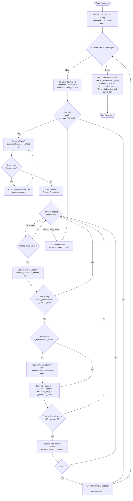

# Journal Review Time Extraction Algorithm

Below is the flowchart detailing the algorithm used to extract and process paper statistics, formatted for a methodology section using generalized variables.

**Inputs:**
* $J$: Set of Target Journals
* $N$: Required Paper Samples per Journal
* $Y_{start}, Y_{end}$: Target Publication Date Range (journal publication year)

**Outputs:**
* $D$: Dataset with, per paper, the review time $t_{review} = t_{accept} - t_{receive}$ when the journal reports it, and the proxy $t_{proxy} = t_{publish} - t_{arXiv}$
* Per-journal summary: sample size, number of measured papers, median and interquartile range

**Date sources, in order of trust:**
1. Crossref article history ($t_{receive}$, $t_{accept}$ deposited by the publisher; Springer and Wiley do this)
2. First page of the arXiv PDF ("Manuscript received ...; accepted ..." footnote; common for IEEE journals)
3. None: only $t_{proxy}$ is available

**Notes for the methodology section:**
* The venue check against Crossref is required because arXiv's journal-reference search matches phrases, so a query for *Robotics and Autonomous Systems* also returns *Annual Review of Control, Robotics, and Autonomous Systems*.
* $t_{publish}$ is the Crossref online publication date, falling back to the DOI registration date (IEEE registers the DOI at Early Access).
* $t_{proxy}$ is reported separately and never mixed with $t_{review}$. Authors who post to arXiv after acceptance give a short or negative proxy, so it is a rough bound, not a review time.
* Papers are sampled most recent first (arXiv submission date, descending), so each journal's sample is its latest $N$ usable papers.
